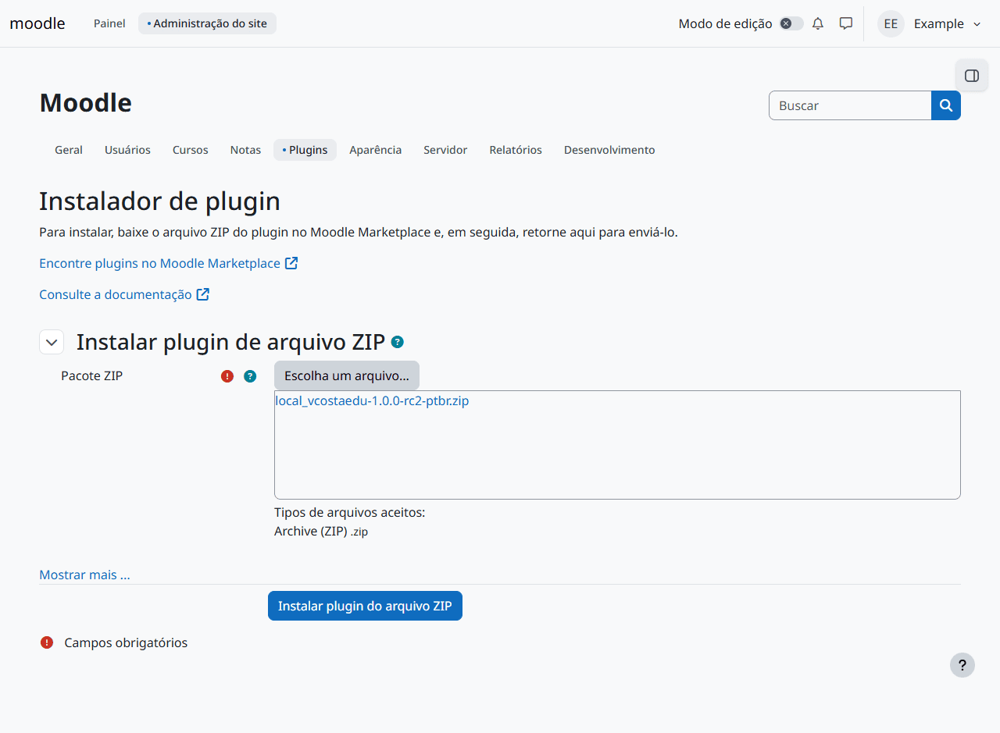
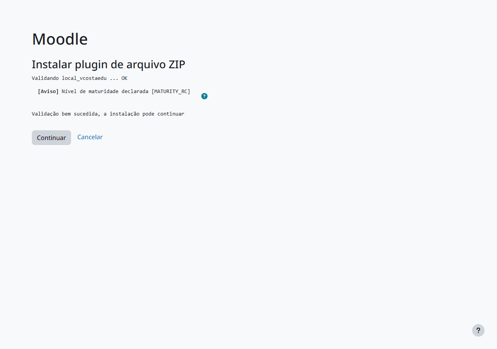
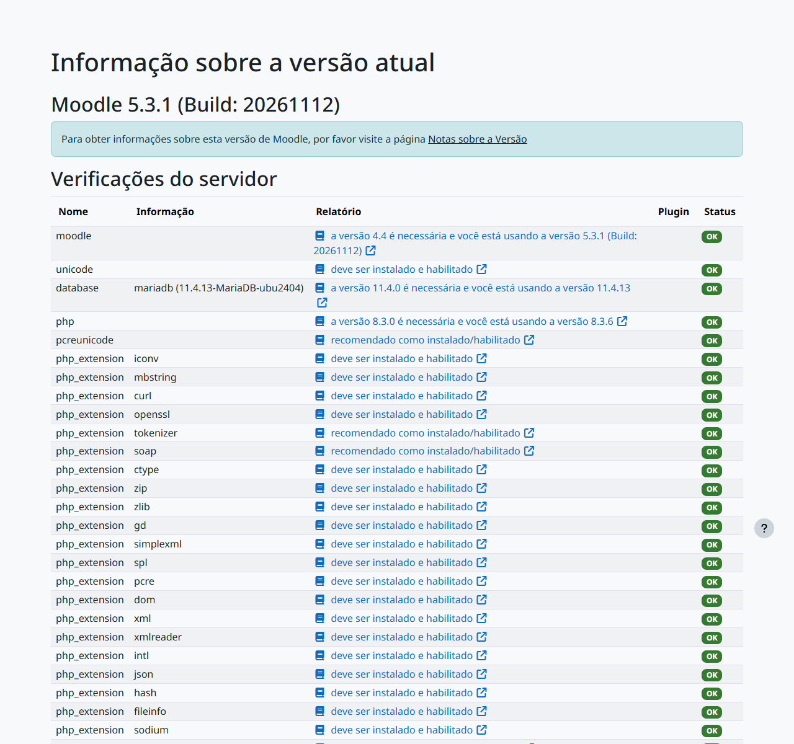
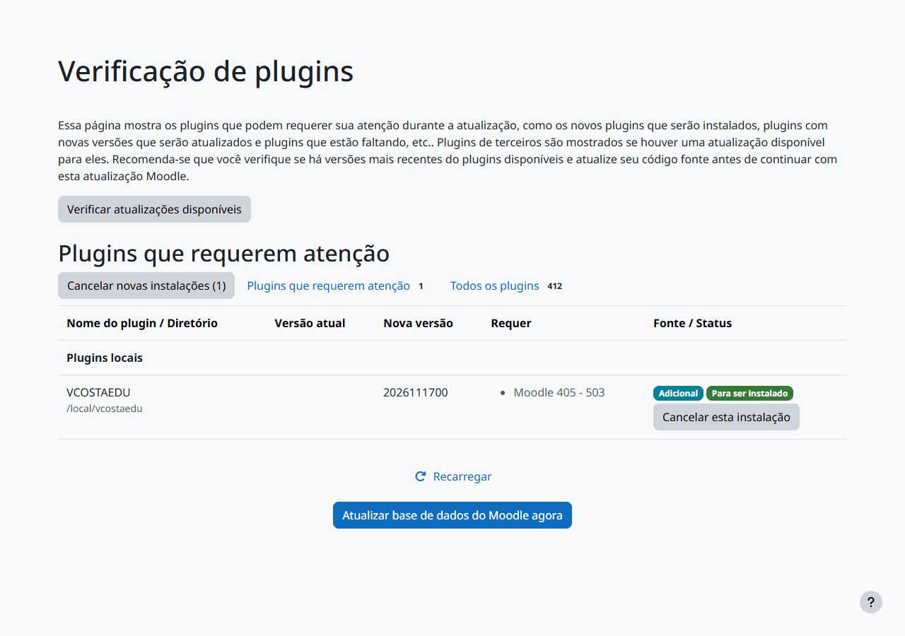
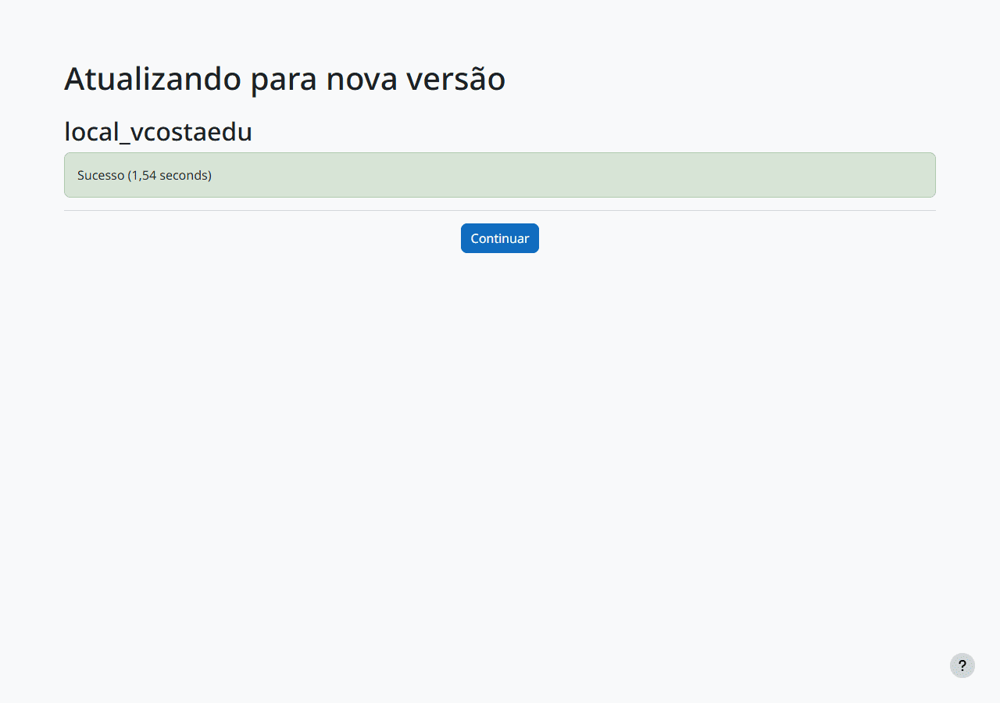
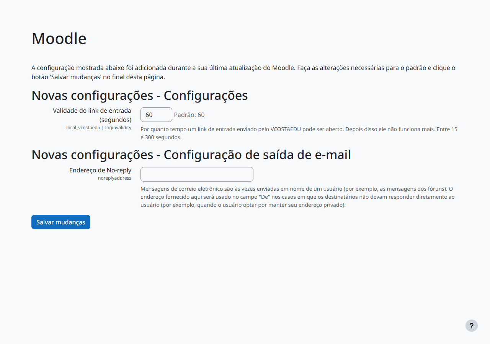
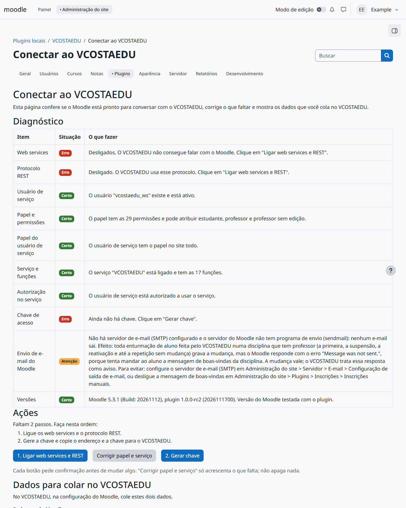
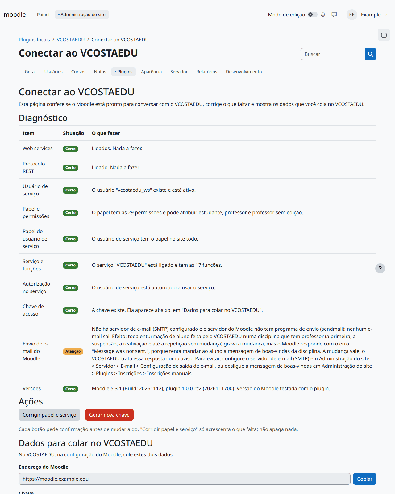

# Como instalar o plugin VCOSTAEDU no Moodle

Este guia é para quem nunca instalou um plugin no Moodle. Ao final, o Moodle estará pronto
para conversar com o VCOSTAEDU, e você terá em mãos os dois dados que o VCOSTAEDU pede: o
endereço do Moodle e a chave.

Leva uns cinco minutos. Você vai precisar de:

- Moodle 4.5 a 5.3;
- uma conta de **administrador do site** no Moodle;
- o pacote do plugin. São dois:
  - `local_vcostaedu-<versão>.zip`: só em inglês, o mesmo pacote do Moodle
    Marketplace;
  - `local_vcostaedu-<versão>-ptbr.zip`: o mesmo, com os textos em português. Para um Moodle
    em português, use este.

English: [INSTALL.md](INSTALL.md).

As imagens são do Moodle 5.3. No Moodle 4.5 as telas têm os mesmos textos, botões e ordem; só a
aparência do tema muda um pouco.

---

## Passo 1. Baixe o pacote do plugin

Baixe o arquivo zip e guarde como ele é. **Não descompacte**: o Moodle recebe o zip.

## Passo 2. Envie o zip pela tela "Instalar plugins"

1. Entre no Moodle com a conta de administrador.
2. Vá em **Administração do site > Plugins > Instalar plugins**.
3. Em **Pacote ZIP**, clique em **Escolha um arquivo...** e escolha o zip (ou arraste o zip
   para a área tracejada).
4. Clique em **Instalar plugin do arquivo ZIP**.



*A tela "Instalar plugins", com o zip escolhido em "Pacote ZIP" e o botão "Instalar plugin do arquivo ZIP".*

> Se o Moodle disser que não tem permissão para escrever na pasta de plugins, pule para o
> [Passo 7](#passo-7-quando-a-pasta-de-plugins-não-aceita-escrita).

## Passo 3. Confira a validação

O Moodle abre o zip e confere se ele é um plugin de verdade. A tela diz **Validando
local_vcostaedu ... OK** e termina com **Validação bem sucedida, a instalação pode
continuar**.

- O aviso **Nível de maturidade declarada [MATURITY_RC]** é esperado: esta versão é uma
  candidata a lançamento. Pode seguir.
- Clique em **Continuar**.



*"Validando local_vcostaedu ... OK", o aviso de maturidade, "Validação bem sucedida" e o botão "Continuar".*

Em seguida o Moodle mostra **Informação sobre a versão atual**, a conferência do servidor
(PHP, banco, extensões). O plugin também confere aqui se o nome do serviço está livre: se
outro serviço externo do site já usa o nome "VCOSTAEDU" ou o nome curto `local_vcostaedu`,
aparece o item **Nome do serviço VCOSTAEDU livre** com erro, e a tela diz o que fazer (renomear ou remover o outro
serviço em *Administração do site > Servidor > Web services > Serviços externos*); nada é
instalado até lá. Itens marcados como **Verificar** são avisos gerais do Moodle, não do
plugin. Role até o fim e clique em **Continuar**.



*O começo da conferência do servidor; o botão "Continuar" fica no fim da página.*

## Passo 4. Atualize a base de dados

O Moodle mostra a **Verificação de plugins**, com o VCOSTAEDU em **Plugins locais**, marcado
como **Para ser instalado**.

1. Clique em **Atualizar base de dados do Moodle agora**.
2. Na tela **Atualizando para nova versão**, espere a mensagem **Sucesso** e clique em
   **Continuar**.



*A "Verificação de plugins" com VCOSTAEDU em "Plugins locais" e o botão "Atualizar base de dados do Moodle agora".*



*"local_vcostaedu" com a mensagem "Sucesso" e o botão "Continuar".*

Na instalação, o plugin cria o papel `vcostaedu_ws`, o usuário de serviço `vcostaedu_ws` com
esse papel no site todo, e o serviço externo "VCOSTAEDU" (nome curto `local_vcostaedu`) com 17
funções. O papel tem só as 29 permissões que essas funções usam, entre elas criar e atualizar
disciplinas (inclusive nome, nome curto, id number, resumo e categoria), usuários e
enturmações; o [guia do revisor](REVIEW.md) (em inglês) lista cada uma com a função que
precisa dela. Papel ou usuário que já tenha esse nome é reaproveitado. Ele **não** liga os web
services: essa decisão é sua, no Passo 6.

## Passo 5. Novas configurações

Em seguida o Moodle mostra a tela **Novas configurações** com o que acabou de chegar.

- Só **Validade do link de entrada (segundos)** é do plugin. Deixe 60, a não ser que o
  VCOSTAEDU peça outro valor. Ela diz por quanto tempo o link de entrada do aluno pode ser
  aberto.
- Se aparecer algum campo do próprio Moodle sem valor (por exemplo o **Endereço de
  No-reply**), preencha. Para o endereço de No-reply, use um endereço da escola que não recebe
  respostas, como `nao-responda@escola.exemplo`.
- Clique em **Salvar mudanças**.



*A tela "Novas configurações" com "Validade do link de entrada (segundos)" em 60 e o botão "Salvar mudanças".*

## Passo 6. Conecte ao VCOSTAEDU

1. Vá em **Administração do site > Plugins > Plugins locais > VCOSTAEDU > Conectar ao
   VCOSTAEDU**.
2. Leia o **Diagnóstico**. Cada linha diz se está **Certo**, se pede **Atenção** ou se tem
   **Erro**, e o que fazer.
3. Quando há mais de uma coisa a fazer, a página mostra uma lista numerada, e os botões levam
   o mesmo número. Faça na ordem. Numa instalação nova são dois:
   1. **Ligar web services e REST**;
   2. **Gerar chave**.

   Cada botão pede confirmação antes de mudar algo.
4. Em **Dados para colar no VCOSTAEDU**, copie o **Endereço do Moodle** e a **Chave** com os
   botões **Copiar**. A chave fica escondida; o botão do olho ao lado dela a mostra, se você
   precisar conferir.
5. No VCOSTAEDU, na configuração do Moodle, cole os dois dados.



*O diagnóstico de uma instalação nova: web services, REST e chave pendentes, a lista numerada e os botões "1. Ligar web services e REST" e "2. Gerar chave".*



*Tudo certo e o bloco "Dados para colar no VCOSTAEDU" com o endereço e a chave escondida.*

Cuidados com a chave:

- ela dá acesso aos dados de alunos e disciplinas; não mande por e-mail nem mostre em reunião
  gravada;
- **Gerar nova chave** (o botão vermelho) derruba a conexão em uso: a chave antiga para na
  hora, e o VCOSTAEDU só volta a funcionar quando você colar a nova lá. Use só se a chave
  vazou.

Sobre o item **Envio de e-mail do Moodle**: se ele pedir atenção, o plugin funciona do mesmo
jeito. O aviso explica o que acontece com as mensagens de boas-vindas das disciplinas e como
resolver.

## Passo 7. Quando a pasta de plugins não aceita escrita

Em muitos servidores, por segurança, o Moodle não pode escrever na própria pasta de plugins.
Nesse caso o envio do zip (Passo 2) avisa que não tem permissão. Não é preciso mudar a
permissão da pasta: quem cuida do servidor instala à mão.

1. Descompacte o pacote. Dentro dele há uma pasta `vcostaedu/`.
2. Copie essa pasta para dentro da pasta `local/` do código do Moodle. O destino depende da
   versão do Moodle:
   - Moodle 4.5 e 5.0: `local/vcostaedu`;
   - Moodle 5.1 ou mais novo: os plugins ficam dentro de `public/`, então o destino é
     `public/local/vcostaedu`.
3. Entre no Moodle como administrador. Ele percebe o plugin novo e mostra as telas dos Passos
   3 e 4. Ou, no servidor, rode como o usuário do servidor web, na pasta do código do Moodle:

   ```
   php admin/cli/upgrade.php
   ```

4. Continue a partir do Passo 5.

---

Ficou com dúvida? O [README](../README.pt_br.md) explica o que o plugin cria no Moodle, e o
[guia do revisor](REVIEW.md) (em inglês) as regras de segurança da entrada por link e os
códigos de erro.
