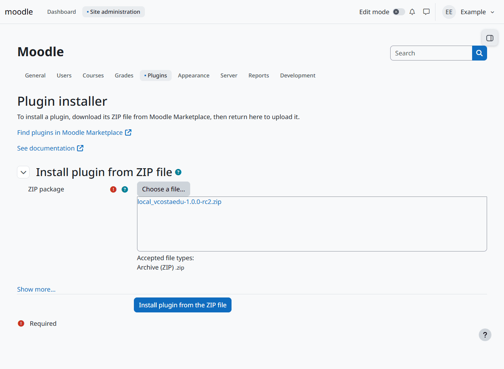
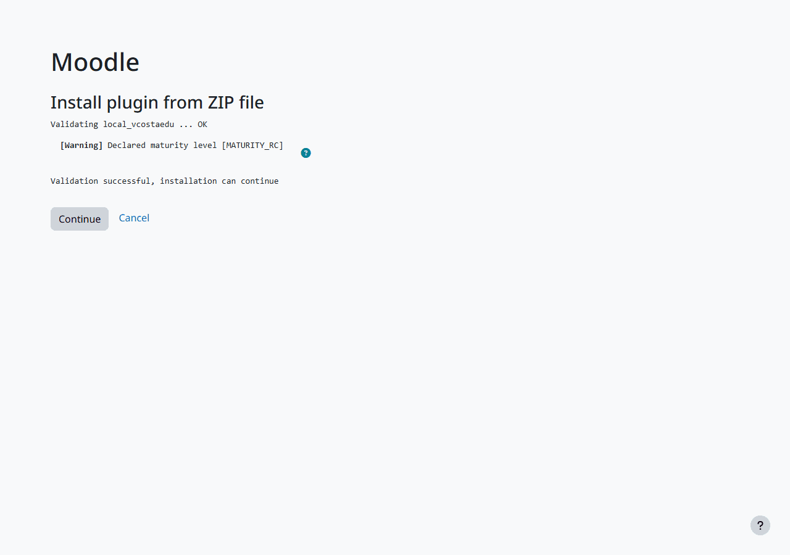
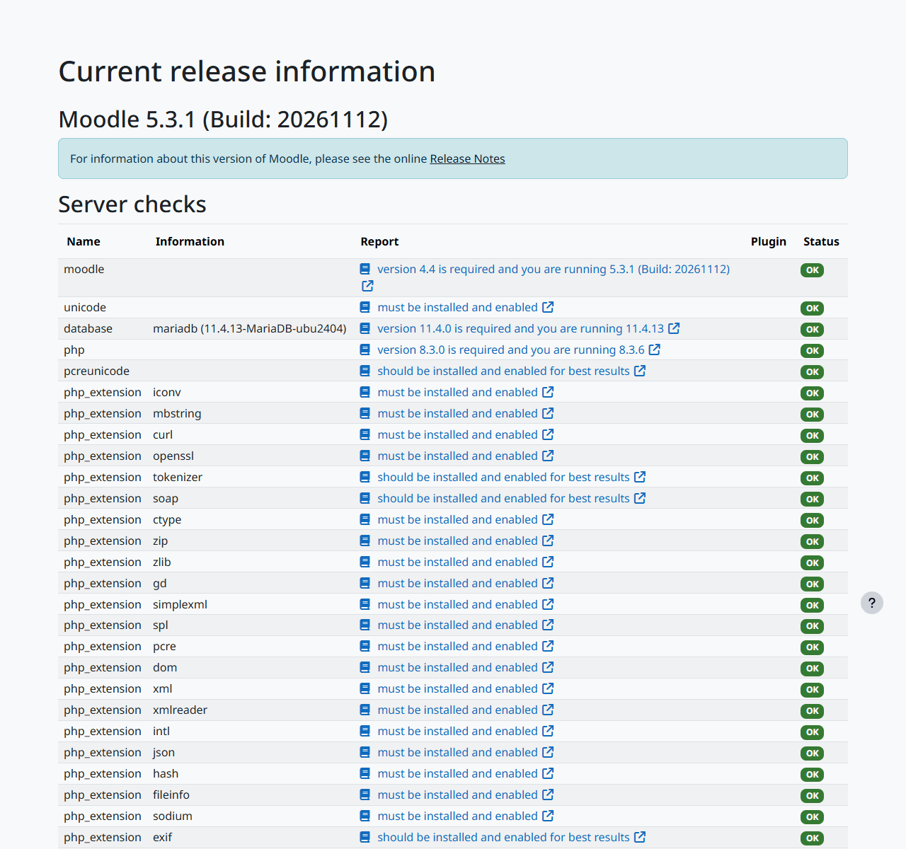
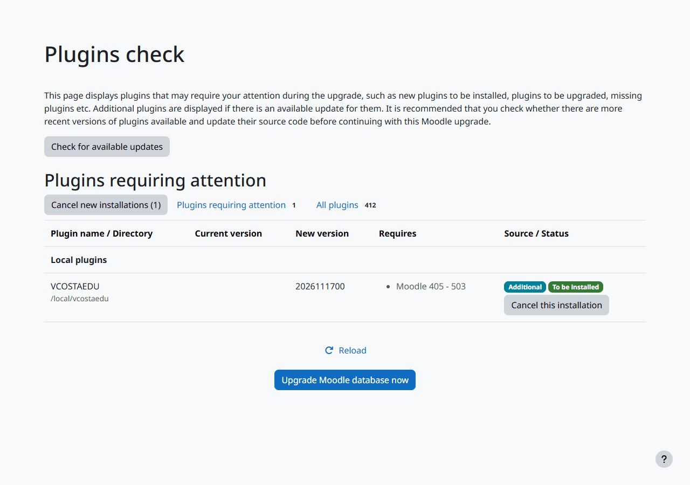
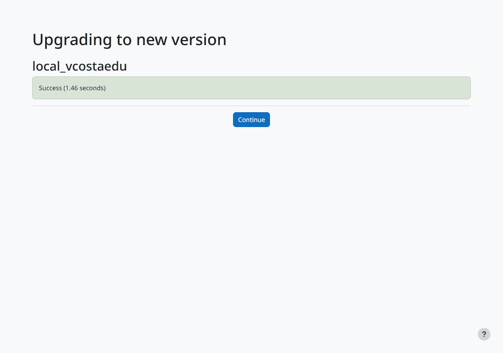
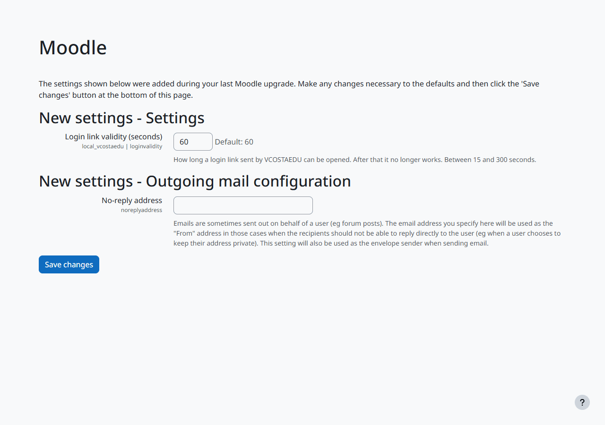
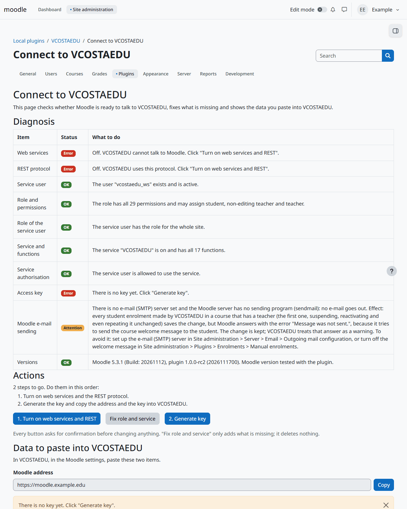
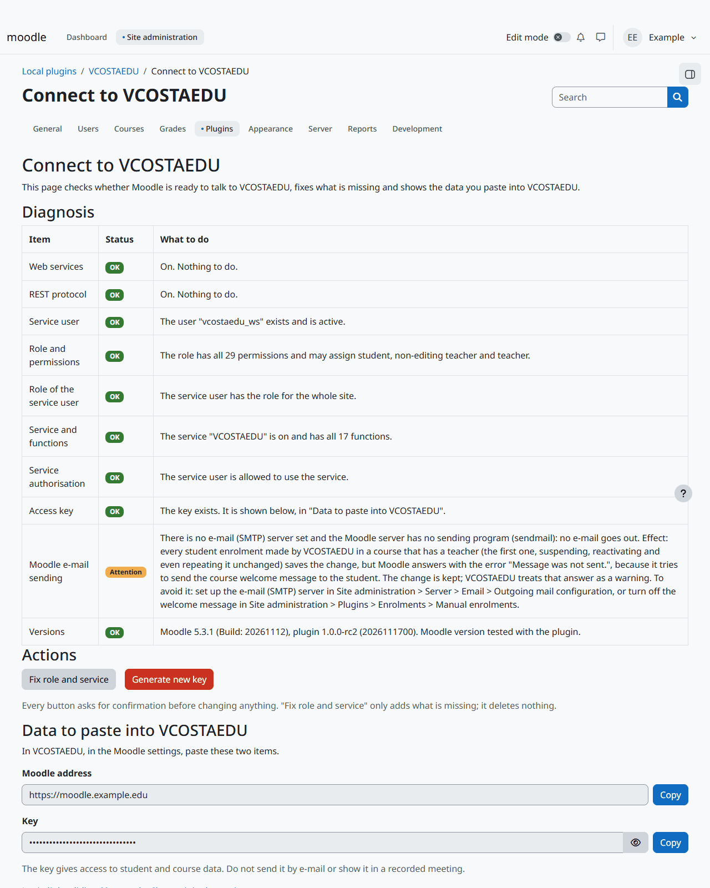

# Installing the VCOSTAEDU plugin in Moodle

This guide is for someone who has never installed a Moodle plugin. At the end, Moodle is
ready to talk to VCOSTAEDU and you have the two items VCOSTAEDU asks for: the Moodle address
and the key.

It takes about five minutes. You need:

- Moodle 4.5 to 5.3;
- a **site administrator** account in Moodle;
- the plugin package. There are two:
  - `local_vcostaedu-<version>.zip`: English only, the same package as in the Moodle
    Marketplace;
  - `local_vcostaedu-<version>-ptbr.zip`: the same, with the texts in Brazilian Portuguese.

Português: [INSTALAR.md](INSTALAR.md).

The screenshots are from Moodle 5.3. On Moodle 4.5 the pages have the same texts, buttons and
order; only the look of the theme is slightly different.

---

## Step 1. Get the plugin package

Download the zip file and keep it as it is. **Do not unzip it**: Moodle takes the zip.

## Step 2. Upload the zip on the "Install plugins" page

1. Log in to Moodle with the administrator account.
2. Go to **Site administration > Plugins > Install plugins**.
3. In **ZIP package**, click **Choose a file...** and pick the zip (or drag the zip onto the
   dashed area).
4. Click **Install plugin from the ZIP file**.



*The "Install plugins" page, with the zip chosen in "ZIP package" and the "Install plugin from the ZIP file" button.*

> If Moodle says it cannot write to the plugins folder, go to
> [Step 7](#step-7-when-the-plugins-folder-is-not-writable).

## Step 3. Check the validation

Moodle opens the zip and checks that it is a valid plugin. The page says
**Validating local_vcostaedu ... OK** and ends with **Validation successful, installation can
continue**.

- The warning **Declared maturity level [MATURITY_RC]** is expected: this version is a release
  candidate. Go on.
- Click **Continue**.



*"Validating local_vcostaedu ... OK", the maturity warning, "Validation successful" and the "Continue" button.*

Next, Moodle shows **Current release information**, a check of the server (PHP, database,
extensions). The plugin also checks here that its service name is free: if another external
service on the site already uses the name "VCOSTAEDU" or the short name `local_vcostaedu`, the
item **VCOSTAEDU service name available** appears as failed, and the page says what to do (rename or remove the other
service in *Site administration > Server > Web services > External services*); nothing is
installed until then. Items marked **Check** are general Moodle warnings, not about the
plugin. Scroll down and click **Continue**.



*The beginning of the server check; the "Continue" button is at the bottom of the page.*

## Step 4. Upgrade the database

Moodle shows **Plugins check**, with VCOSTAEDU listed under **Local plugins** as **To be
installed**.

1. Click **Upgrade Moodle database now**.
2. On **Upgrading to new version**, wait for **Success** and click **Continue**.



*"Plugins check" with VCOSTAEDU under "Local plugins" and the "Upgrade Moodle database now" button.*



*"local_vcostaedu" with the "Success" message and the "Continue" button.*

During the installation the plugin creates the role `vcostaedu_ws`, the service user
`vcostaedu_ws` with that role for the whole site, and the external service "VCOSTAEDU" (short
name `local_vcostaedu`) with 17 functions. The role has only the 29 permissions those functions
use, among them creating and updating courses (including their name, short name, id number,
summary and category), users and enrolments; the [reviewer guide](REVIEW.md) lists each one with
the function that needs it. A role or user that already has that name is reused. It does
**not** switch on web services: that is your decision, in Step 6.

## Step 5. New settings

Moodle then shows **New settings** with what just arrived.

- Only **Login link validity (seconds)** belongs to the plugin. Keep 60 unless VCOSTAEDU asks
  for another value. It is how long the student login link can be opened.
- If a Moodle setting without a value also appears (for example **No-reply address**), fill it
  in. For the no-reply address, use an address of the school that does not receive replies,
  such as `noreply@school.example`.
- Click **Save changes**.



*"New settings" with "Login link validity (seconds)" set to 60 and the "Save changes" button.*

## Step 6. Connect to VCOSTAEDU

1. Go to **Site administration > Plugins > Local plugins > VCOSTAEDU > Connect to VCOSTAEDU**.
2. Read the **Diagnosis**. Each line says **OK**, **Attention** or **Error**, and what to do.
3. When there is more than one thing to do, the page shows a numbered list and the buttons
   carry the same numbers. Do them in order. On a new installation there are two:
   1. **Turn on web services and REST**;
   2. **Generate key**.

   Every button asks for confirmation before changing anything.
4. In **Data to paste into VCOSTAEDU**, copy the **Moodle address** and the **Key** with the
   **Copy** buttons. The key is hidden; the eye button next to it shows it, if you need to
   check it.
5. In VCOSTAEDU, in the Moodle settings, paste both items.



*The diagnosis of a new installation: web services, REST and key missing, the numbered list and the "1. Turn on web services and REST" and "2. Generate key" buttons.*



*Everything OK and the "Data to paste into VCOSTAEDU" block with the address and the hidden key.*

About the key:

- it gives access to student and course data; do not send it by e-mail or show it in a
  recorded meeting;
- **Generate new key** (the red button) breaks the connection in use: the old key stops at
  once, and VCOSTAEDU works again only after you paste the new one there. Use it only if the
  key leaked.

About the **Moodle e-mail sending** item: when it asks for attention, the plugin works anyway.
The message explains what happens to the course welcome messages and how to solve it.

## Step 7. When the plugins folder is not writable

On many servers, for safety, Moodle cannot write to its own plugins folder. Then uploading the
zip (Step 2) says so. There is no need to change the folder permissions: whoever runs the
server installs the plugin by hand.

1. Unzip the package. It has a `vcostaedu/` folder inside.
2. Copy that folder into the `local/` folder of the Moodle code. The target depends on the
   Moodle version:
   - Moodle 4.5 and 5.0: `local/vcostaedu`;
   - Moodle 5.1 and later: plugins live inside `public/`, so the target is
     `public/local/vcostaedu`.
3. Log in to Moodle as an administrator. Moodle notices the new plugin and shows the screens of
   Steps 3 and 4. Or, on the server, run as the web server user, in the Moodle code folder:

   ```
   php admin/cli/upgrade.php
   ```

4. Go on from Step 5.

---

Questions? The [README](../README.md) explains what the plugin creates in Moodle, and the
[reviewer guide](REVIEW.md) the security rules of the login link and the error codes.
